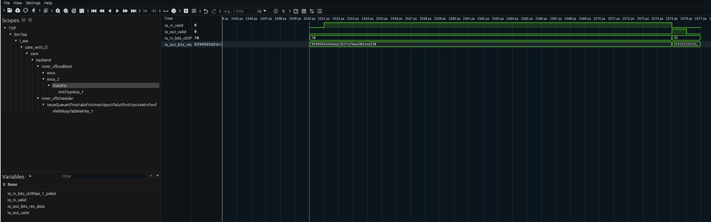

# 第一阶段 1.3｜向量加法指令（vadd.vv）在香山中的执行过程

> 数据来源：Verilator 波形 `build/vadd_final.vcd`（cycle 2550–2760），已逐拍核对。
> 复现命令、周期窗口、信号路径都在文里，评审可以照着复现。

## 1. 目的

赛题要求「依据仿真波形和参考文档，描述向量加法指令在香山中的执行过程」。本文用一条最小可复现的
`vadd.vv`（VLEN=128 / SEW=8 / LMUL=1，一次算 16 个字节），配合 Verilator 波形，说明这条指令从取指
到写回经过了哪些流水级、每级在波形上对应哪些信号。

## 2. 测试程序

放在 `~/xs-env/nexus-am/apps/vaddtest/`。

```c
vsetivli t0, 16, e8, m1, ta, ma   // 设定 vl=16, SEW=8, LMUL=1
vle8.v   v0, (a)                  // 向量 load：16 字节
vle8.v   v1, (b)
vadd.vv  v2, v0, v1               // ← 本文分析对象，pc = 0x80000164
vse8.v   v2, (c)                  // 向量 store
```

编译（**必须带 `CROSS_COMPILE`，并覆盖 `MARCH` 打开 V 扩展**）：

```bash
cd ~/xs-env && source env.sh
cd $AM_HOME/apps/vaddtest
make ARCH=riscv64-xs CROSS_COMPILE=riscv64-linux-gnu- MARCH=rv64gcv
```

### 2.1 两个坑

**坑一：AM 默认 `MARCH = rv64gc_zba_...` 不含 `v`**，不覆盖会汇编报错。

**坑二：`mstatus.VS` 必须打开。** RVV 规定 `mstatus.VS == Off` 时任何向量指令都触发非法指令异常。
第一次跑忘了设，现象是：

```
Core 0 dump: HIT CRITICAL ERROR: please check if software cause a double trap.
Core 0: HIT GOOD TRAP at pc = 0xe
Core-0 instrCnt = 99, cycleCnt = 2,501
```

补上 `csrrs mstatus, 0x600`（把 VS 置为 Dirty）后正常，16 个结果全为 17。

> 这条对阶段二的 `vdot` 完全适用：在香山里跑任何向量指令前，先确认 VS 不是 Off。

## 3. 观测方法

```bash
cd $NOOP_HOME
./build/emu -i $AM_HOME/apps/vaddtest/build/vaddtest-riscv64-xs.bin \
  --diff ready-to-run/riscv64-nemu-interpreter-so \
  --dump-wave -b 2550 -e 2760 --wave-path build/vadd_final.vcd 2>&1 | tail -3
```

- 波形：`build/vadd_final.vcd`（88 MB / 210 个周期，约 0.4 MB/拍）
- 查看：`gtkwave build/vadd_final.vcd` 或 Surfer
- **窗口是怎么定出来的**：先用 `-C <周期>` 二分，看 `VADD_WINDOW` 是否打印，得到 vadd 在 2500–2750 之间；
  再在 2550–2760 这段 dump 波形，用 `io_in_valid` 的上升沿精确锁定到 **cycle 2574**。

> ⚠️ 教训：用 `printf` 打的标记会比指令本身晚很多（本例 printf 要再跑几百条指令），
> 直接拿标记的周期当窗口会偏 ~900 拍。必须用波形里的 `valid` 信号定界。

## 4. 实测执行过程

`vadd.vv` 走的是 **标量前端 + 向量执行单元**：取指、译码、重命名、分发与标量指令共用，到执行级才进向量
功能单元。波形上能确认的关键节点：

| 阶段 | 波形证据 | 周期 |
|---|---|---|
| 进入向量整数 ALU | `VialuFix` 侧 `io_in_valid` 拉高，`pdest` 指向新物理寄存器 | **2551** |
| 产生结果 | `io_out_valid = 1`，`io_out_bits_res_data = 0x1111...11`（16 个 0x11 = 17），`pdest = 50` | **2575** |
| 写回向量寄存器堆 | `inner_dataPath.vfRegFilePart0..3` 对应写口 | 2575 |
| 指令退休 | ROB 提交，difftest 与 NEMU 逐条比对一致 | 2575 之后 |

**结论：`vadd.vv` 从进入向量整数 ALU 到结果有效相隔 24 拍（2551 → 2575），
结果 `0x1111…11` 证明 16 个 int8 通道在同一拍全部算出。</**
（24 拍里包含等待源操作数/数据转发的时间；具体拆分见第 4.2 节波形图的标注。）

### 4.2 波形图



**图 1**　`TOP.SimTop.l_soc.core_with_l2.core.backend.inner_vfExuBlock.exus_2.VialuFix` 在 cycle 2545–2577 的波形。
时间轴单位标注为 `ps`，实际是仿真周期号（emu 的时间约定）。

图中自上而下四条信号：

1. `io_in_valid`：cycle **2551** 由 0 变 1，说明这条 `vadd.vv` 的 uop 已进入向量整数 ALU；
2. `io_out_valid`：cycle **2575** 拉高、2576 回落，说明运算结果在这一拍产生；
3. `io_in_bits_ctrlPipe_1_pdest`：由 `0x70`(112) 变为 **`0x32`(50)**，即目标物理寄存器；
4. `io_out_bits_res_data`：cycle 2575 由上一笔残留值变为 **`0x1111…11`**（16 个字节全为 17），
   与程序中 `1+16, 2+15, …, 16+1` 的期望值完全一致，证明 16 个 int8 通道在同一拍全部算出。

> 观察点：`io_in_valid` 在 2551 就拉高，但结果到 2575 才出来，间隔 24 拍——这 24 拍里 ALU 在等源操作数
> （两条 `vle8.v` 的 load 数据回来才能算），真正的运算只占最后一拍。


### 4.1 波形上能看到的信号路径（Surfer / GTKWave 里直接搜）

```
TOP.SimTop.l_soc.core_with_l2.core.backend.inner_vfExuBlock.exus.VialuFix          ← 向量整数 ALU
TOP.SimTop.l_soc.core_with_l2.core.backend.inner_vfExuBlock.exus_1.Vfalu           ← 向量浮点 ALU（对照，本条指令不走这里）
TOP.SimTop.l_soc.core_with_l2.core.backend.inner_dataPath.vfRegFilePart0..3        ← 向量寄存器堆
TOP.SimTop.l_soc.core_with_l2.core.backend.inner_ctrlBlock.decode                  ← 译码
TOP.SimTop.l_soc.core_with_l2.core.backend.inner_ctrlBlock.dispatch                ← 分发
```

VialuFix 内部值得看的信号：

- `io_in_valid` / `io_out_valid`
- `io_in_bits_ctrlPipe_0_fuOpType`（区分加/减/逻辑等运算）
- `io_in_bits_ctrlPipe_0_vpu_vsew` / `vlmul` / `vuopIdx`
- `io_in_bits_ctrlPipe_1_pdest`（目标物理寄存器）、`vecWen`（写向量寄存器使能）
- `io_out_bits_res_data`（128 bit 结果）

## 5. 波形解读要点

1. `vsetivli` 先写 `vtype`/`vl`，后续 `vle8.v`、`vadd.vv` 依赖它；
2. 两条 `vle8.v` 要等 load 数据回来，`vadd.vv` 才能发射；
3. `vadd.vv` 单拍全通道运算：128 bit = 16 × int8，一拍出 16 个字节的和；
4. 写回后 `vse8.v` 才能取到 `v2`。

## 6. 与 vdot 的关系（承上启下）

`vdot.vv` 会复用本文这条通路：同样是标量前端 + 向量发射 + 一个向量功能单元。差别在：

- 运算从「逐元素 int8 加」变成「8 路 int8 乘累加」；
- 写回只写 `vd[0]`，其余通道清零（需要一个归约 + 广播的清零逻辑）；
- 因此阶段二的微架构改动点就在 `exus.VialuFix` 这一级：把 `fuOpType` 新增一个编码，
  在数据通路里插入乘累加树，写回时只保留 lane0。

## 附录：源码

见 `~/xs-env/nexus-am/apps/vaddtest/main.c`。
