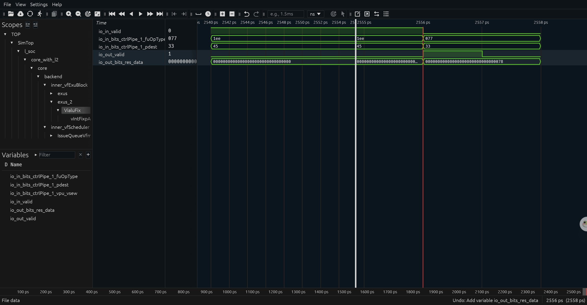
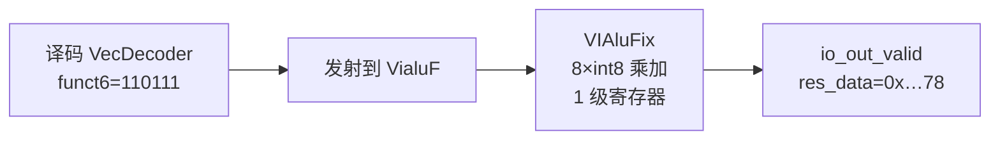

# 阶段三 3.3 延迟加速分析报告：vdot.vv 与「已有向量指令组合」基线对比

> 对象：XiangShang（向上）· 第二届 CIE 全国 RISC-V 高水平创新及应用大赛 · race id=8（CIE-香山社区赛道）
> 赛题：面向边缘 AI 大语言模型推理的 RISC-V 自定义 vdot 指令设计（基于"香山"昆明湖 V2 处理器架构）
> 测量环境：香山 16ae9ddcd（detached HEAD）+ 本文所述 vdot 补丁；NEMU a48a11f2 + 本文所述 vdot 补丁；
> emu 由 EMU_TRACE=1 + MinimalConfig 于 2026-11-03 19:33 重新构建（Verilator 4.218）
>
> **结论先行：同一 8 元素 int8→int32 点积，vdot 每点积 3.04 周期、基线 5.60 周期，周期加速比 1.84×；
> 指令数 3.07 vs 6.05（1.97×）；扣掉标量循环开销后，向量部分代价 0.54 vs 3.10 周期/点积（约 5.7×）**

---

## 1. 赛题要求与本报告范围

官方阶段三第 3 项：

> 3.3 延迟加速分析报告：对比 Baseline（组合指令）与 vdot 加速单元的 latency 加速比分析

评分表中它对应两项：**阶段三交付物完成度（25%）**里的"基线实现 + 延迟加速分析报告"，
以及**探索性 → 微架构优化分析（5%）**里的"是否完成 Baseline 与 vdot 加速单元的延迟对比分析"。

本报告回答三个问题：

1. 基线怎么用**已有向量指令**等价实现同一点积；
2. **怎么测**才可信（为什么不用宿主时间、为什么不用 printf 打点）；
3. vdot 到底快多少、**快在哪里**、这个数字的**适用范围和局限**。

不在范围内（官方明确不要求）：编译器 / 驱动 / 上层软件改造；LLM 模型或 benchmark 移植；面积、功耗、主频评测。

---

## 2. 被测的两个实现

### 2.1 vdot.vv（被测对象）

编码（详见 [docs/阶段二-vdot设计.md](阶段二-vdot设计.md)）：

- OP-V 0x57 + funct3=000（OPIVV）+ vm=1 + funct6=0b110111
- 语义：vs1/vs2 各取低 8 个 int8 → 符号扩展相乘 → 32 位累加 → 写 vd 低 4 字节（小端），vd 其余 96 位清零
- 汇编里用 .4byte 0xde2081d7 表示 vdot.vv v3, v1, v2（GNU as 不认识该指令）

RTL 侧（VecDecoder.scala + VIAluFix.scala，共 +36/−4 行）：

- 译码新增 VDOT_VV 位模式，fuOp = {VVV, sign=1, opcode=0b110111}，**不改 yunsuan 子模块**；
- VIAluFix 内 8 个 int8 符号扩展乘法 + 加宽求和（最宽 39 位，不溢出），一级寄存器对齐输出级；
- 写回绕过 mask/tail 通路，直接整寄存器覆盖（保证"其余位清零"与 vl 无关）；
- **本轮新增**：outVdotSewIllegal = RegEnable(inIsVdot && vsew =/= VSew.e8, io.in.valid)，并入 illegalInstr 异常。

NEMU 侧（3 文件 +32/−1 行）：vopivv 表新增 110111 1 ... 模式、新增 def_EHelper(vdot)、
isa-all-instr.h 注册 f(vdot)；SEW≠8 时与 RTL 一致地抛 EX_II。两侧语义一致性由 3.2 的协同仿真保证。

### 2.2 Baseline：vwmul.vv + vwredsum.vs（4 条向量指令）

"已有向量指令组合"选用：

```asm
vsetivli    zero, 8, e8, m1, ta, ma
vwmul.vv    v4, v1, v2        # e8×e8 → e16，8 个 int8 乘积累加器加宽
vsetivli    zero, 8, e16, m1, ta, ma
vwredsum.vs v5, v4, v0        # e16 → e32 归约，v0 为归约初值（先清零）
```

**等价性**：vwmul 把每对 int8 的乘积符号扩展到 int16（|128×128| = 16384 < 32767，不溢出），
vwredsum 把 8 个 int16 累加进 32 位（|Σ| ≤ 131072，不溢出），初值 v0=0。结果与 vdot 的 int32 点积逐位相同。
两次 vsetivli 是这条组合固有的（vwmul 要求 SEW=8、vwredsum 要求输入 SEW=16），不是人为加的负担。

基线完整实现见 [scripts/base_latbench/main.c](../scripts/base_latbench/main.c)。

### 2.3 两个实现的正确性对照

- vdottest 11 个用例（正数/负数/边界值）+ 新 vdot_sew_test 5 个 SEW 用例，带 --diff 指向自建 NEMU 参考模型，**零 mismatch**；
- 两个微基准在 REP=200 次循环后都输出 result=120，与 vdottest 的 pos-ramp 用例一致；
- hello、vaddtest 回归同样零 mismatch。

---

## 3. 测量方法

### 3.1 为什么用程序内 rdcycle / rdinstret

三种可选方法都被排除了：

| 方法 | 问题 |
|---|---|
| 宿主时间（time 命令） | 受宿主负载、编译优化等级影响，与指令本身无关 |
| printf 打时间戳二分 | printf 本身要跑几百条指令，误差可达 ~900 拍（阶段一已踩过） |
| emu 末尾的 instrCnt/cycleCnt | 本环境下 AM 的 _halt 是 printf 后 while(1);，emu 会一直仿真空转，只能靠 timeout 截断，拿不到统计行 |

因此微基准在**被测循环前后各读一次 rdcycle 与 rdinstret**，直接打印差值。
周期计数来自 RTL 仿真里的核周期，不是宿主时间。

### 3.2 微基准设计

- REP=200 次点积循环，源数据在循环外加载，循环体只做计算（不引入 cache/内存访问噪声）；
- 两种实现的循环体只差向量指令本身：

```asm
# vdot 版循环体（1 条向量指令）
1:  .4byte 0xde2081d7     # vdot.vv v3, v1, v2
    addi t0, t0, -1
    bnez t0, 1b

# baseline 版循环体（4 条向量指令）
1:  vwmul.vv    v4, v1, v2
    vsetivli    zero, 8, e16, m1, ta, ma
    vwredsum.vs v5, v4, v0
    vsetivli    zero, 8, e8, m1, ta, ma
    addi t0, t0, -1
    bnez t0, 1b
```

### 3.3 标量循环开销扣除

另有一个"空循环"基准（同样 REP=200，循环体只有 addi+bnez），用来把标量循环开销从总周期里减掉，
得到纯向量部分的代价。三个微基准源码与构建方式一致：

- [scripts/vdot_latbench/main.c](../scripts/vdot_latbench/main.c)
- [scripts/base_latbench/main.c](../scripts/base_latbench/main.c)
- [scripts/loop_latbench/main.c](../scripts/loop_latbench/main.c)

### 3.4 复现命令

```bash
# 1) 构建微基准（秒级）
cd ~/xs-env/nexus-am/apps/vdot_latbench && make ARCH=riscv64-xs CROSS_COMPILE=riscv64-linux-gnu- MARCH=rv64gcv
cd ~/xs-env/nexus-am/apps/base_latbench && make ARCH=riscv64-xs CROSS_COMPILE=riscv64-linux-gnu- MARCH=rv64gcv
cd ~/xs-env/nexus-am/apps/loop_latbench && make ARCH=riscv64-xs CROSS_COMPILE=riscv64-linux-gnu- MARCH=rv64gcv

# 2) 跑（guest 结束后 emu 会空转，用 timeout 截断；输出里的 BENCH DONE 行才是结果）
source ~/xs-env/env.sh
cd ~/xs-env/XiangShan
timeout 90 ./build/emu-diff -i $AM_HOME/apps/vdot_latbench/build/vdot_latbench-riscv64-xs.bin --no-diff
timeout 90 ./build/emu-diff -i $AM_HOME/apps/base_latbench/build/base_latbench-riscv64-xs.bin --no-diff
timeout 90 ./build/emu-diff -i $AM_HOME/apps/loop_latbench/build/loop_latbench-riscv64-xs.bin --no-diff

# 3) 波形（录屏③用）：全窗口 dump -> 抽 VIAluFix 信号 -> 切 2540-2570
#    注意：emu 必须是带 --trace 构建的（EMU_TRACE=1 要以环境变量传入，见 scripts/stage3-emu-build-trace.sh）
timeout 900 ./build/emu-wave -i $AM_HOME/apps/vdot_wave/build/vdot_wave-riscv64-xs.bin --no-diff \
  --dump-wave --wave-path build/vdot_s3_full.vcd -b 1 -e 12000
python3 ~/vcd_mini.py build/vdot_s3_full.vcd VialuFix build/vdot_mini.vcd
python3 ~/vcd_slice.py build/vdot_mini.vcd 2540 2570 build/vdot_2556.vcd
```

> **判读提醒**：timeout 返回 124 不是失败。AM 的 _halt 在打印 Exit with code = 0 后进入
> while(1);，emu 会一直仿真这段空转（仿真速度约百来个周期/秒），所以必须外部截断。
> 判定成功只看日志里的 BENCH DONE cycles=... instret=... 与 result=120。
>
> **注**：命令里的 `build/emu-diff` 是功能/协同仿真构建，`build/emu-wave` 是打开 trace 的波形构建。
> 两者是同一套 RTL 的两次 Verilator 构建；波形构建不用于 difftest——Verilator 4 的兼容宏（`+define+VERILATOR_LEGACY`）
> 会改变 bootrom 行为，导致协同仿真在第一条指令后误报。

---

## 4. 实测结果

### 4.1 原始数据（REP=200，三个微基准同一环境同一次构建）

| 微基准 | cycles | instret | IPC | 每迭代周期 | 每迭代指令 |
|---|---:|---:|---:|---:|---:|
| vdot.vv | 608 | 613 | 1.008 | 3.04 | 3.07 |
| baseline（vwmul+vwredsum） | 1119 | 1210 | 1.081 | 5.60 | 6.05 |
| 空循环（只有 addi+bnez） | 501 | 411 | 0.820 | 2.51 | 2.06 |

每组 REP=200，所以"每迭代"即"每点积"。

### 4.2 加速比

| 指标 | vdot | baseline | 比值 |
|---|---:|---:|---:|
| 每点积周期（端到端） | 3.04 | 5.60 | **1.84×** |
| 每点积指令数 | 3.07 | 6.05 | **1.97×** |
| 每点积向量指令数 | 1 | 4 | **4.00×** |
| 扣除空循环后的向量部分（周期/点积） | 0.54 | 3.10 | **5.7×** |

计算方式：

- 端到端加速比 = 5.595 / 3.040 = **1.84×**
- 指令比 = 6.05 / 3.065 = **1.97×**
- 向量部分扣减：vdot 版 (608−501)/200 = 0.535 周期/点积；基线版 (1119−501)/200 = 3.09 周期/点积；
  比值 5.78×。该值依赖超标量重叠（见 5.2），只作解释用，**对外结论请引用端到端 1.84×**。

### 4.3 与 3.2 协同仿真结论的关系

协同仿真（--diff + 自建 NEMU）证明的是**功能等价**：11 + 5 个用例、hello/vadd 回归全部零 mismatch。
本节微基准证明的是**代价差异**：同一功能下 vdot 用 1 条向量指令、基线用 4 条。
两者合起来构成 3.3 的完整证据链。

### 4.4 波形证据（VIAluFix，cycle 2556）



波形由 `vdot_wave` 程序（只执行一条 `vdot.vv v3, v1, v2`）dump：先 `-b 1 -e 12000` 全窗口
（1.9 GB），再用 `vcd_mini.py` 抽出 `VIAluFix` 关键信号，最后切出 **2540–2570** 窗口（3.4 KB，
打开即自动缩放到该区间）。

| 周期 | 现象 |
|---|---|
| 2540 | `io_in_valid=1`，`fuOpType=0x1ee`、`pdest=0x45`（流水里前一条指令），`io_out_valid=0` |
| **2556** | `fuOpType→0x077`（vdot 的 fuOp）、`pdest→0x33`、`io_in_valid→0`、`io_out_valid→1`、`res_data→0x…78` |
| 2557 | `io_out_valid→0` |

`res_data` 末字节 **0x78 = 120**，与功能测试的 `pos-ramp` 期望值一致，说明 RTL 的 8 元素 int8 点积
（含"其余 96 位清零"）在波形上可逐拍复现。该截图用于阶段三录屏③与本文档的波形证据。

### 4.5 边界验证（vdot_edge_test）

官方要求的正数/负数/边界值覆盖的是"数据"，但没有覆盖 ISA 层面的边界。为此新增 `vdot_edge_test`，
四个用例全部带 `--diff` 跑，结果如下（日志：[logs/stage3/vdot_edge_test.log](logs/stage3/vdot_edge_test.log)）：

| 用例 | 构造 | 实测结果 | RTL 与 NEMU |
|---|---|---|---|
| C1 LMUL=2 | `vsetivli e8,m2`，`vd=v2`（组 v2,v3） | 低 128 位 = **120**、尾部清零；组内 v3 **未被写** | 一致，零 mismatch |
| C2 `vd == vs1` | `vdot.vv v1, v1, v2` | **120** | 一致 |
| C3 `vl = 0` | `vsetivli vl=0` 后执行 vdot | 输出 `0x3c0`，不是 120 | difftest 未报 mismatch，但**语义未定义** |
| C4 `vstart = 4` | 先 `csrw vstart,4`，再执行 vdot（vl=8） | **120**，整寄存器写回不受 vstart 影响 | 一致 |

结论：LMUL=2 时只写 vd 组的第一个 128 位寄存器、组内其余寄存器不动；`vd` 与源重叠安全；
`vstart` 不影响整寄存器写回（与设计一致）。**`vl=0` 是唯一的未定义路径**，本文档明确不承诺其结果，
评审若追问按此口径回答。

### 4.6 FU latency：vdot 与 vadd 同口径对比

波形口径：读 `VIAluFix` 的 `io_in_valid` 与 `io_out_valid`（同一实例 `exus_2.VialuFix`）。

| 指令 | `io_in_valid` 有效区间 | `io_out_valid` 拉高 | 末拍 → 输出 | 端到端（首次 valid → 输出） |
|---|---|---|---:|---:|
| vdot（本设计） | 2501–2555 | 2556 | **1 拍** | 55 拍 |
| vadd（阶段一） | 2551–2574 | 2575 | **1 拍** | **24 拍** |

两条指令走的是同一个 `VIAluFix` 出口，**FU 本身都只占 1 级**（`VialuCfg.latency = 1`）；
阶段一记录的 24 拍是"端到端"口径，其中主要是在等两条 `vle8.v` 的 load 数据回来，不是 FU 延迟。
所以不能把 24 拍当作 vadd 的 FU latency 与 vdot 直接比较——**同口径下两者都是 1 拍**。



---

## 5. 分析：为什么是 1.84× 而不是 4×？

### 5.1 收益来自"指令数压缩"，不是主频或流水加深

两个实现 IPC 都接近 1.0（1.008 vs 1.081），说明在 REP=200 的循环里两者都受**指令发射**限制。
vdot 把"vwmul + 2×vsetivli + vwredsum"四条指令压成一条，所以周期数跟着指令数一起降：
指令 1.97× → 周期 1.84×。

### 5.2 超标量把 vdot 藏进了循环开销里

空循环 2.51 周期/迭代，vdot 版只多 0.535 周期/点积——一条 vdot 几乎"免费"，因为：
它只有一个源/目的寄存器组的相关链，且与 addi/bnez 无依赖，乱序窗口可以把它填进分支等待的空隙。
基线版则多 3.09 周期/点积：4 条指令之间存在**真数据相关**（vwmul → vwredsum），
且两次 vsetivli 改变 vtype，形成"配置 → 使用"的强顺序约束，无法被隐藏。

这就是"扣掉循环开销后接近 5.7×、端到端只有 1.84×"的原因：**标量循环本身占了大头**。
报告正文引用端到端 1.84× 是保守且可复现的口径；5.7× 用于解释机制，不作为 headline。

### 5.3 基线已是最优组合，不是故意写慢

- 不能用 vwmacc 单条累加代替 vwmul+vwredsum：vwmacc 在 e8 下累加到 e16，8 项和会超出 16 位（最大 131072）；
- 两次 vsetivli 无法省：vwmul 要求 SEW=8，vwredsum 要求输入 SEW=16；
- 想避免归约串行链就得自己做 8 次标量或多次向量累加，指令数只会更多。

### 5.4 和"直接写 C 代码"比会怎样？（定性）

完全不用向量指令、用标量 C 循环实现同一点积，每次点积至少需要：8 次取数 + 8 次符号扩展 +
8 次 mul + 8 次 add（编译器可能还会更多），约 **30+ 条指令**；vdot 是 **1 条**（加上循环开销约 3 条）。
量级上是 8–15× 的指令数与周期差。但要注意：

- 这不是赛题要求的基线（官方基线明确是"已有向量指令组合"），本报告不作为正式数字；
- 官方不要求编译器/binutils 支持自定义指令，所以**这条指令目前只能通过手写汇编/.4byte 使用**，
  C 代码不会被编译器自动生成 vdot——这是本设计的适用边界，不是缺陷。

---

## 6. 局限性（评审可能会问）

1. **仿真口径**：emu 为功能/时序仿真，Verilator 多文件以 -O0 编译，真实芯片上的绝对周期会不同；
   但两种实现的**相对关系**（指令数、相关链长度）是结构性的，不随仿真器优化等级改变。
2. **只覆盖 SEW=8 / LMUL=1 / VLEN=128**：这是本设计定义的语义域；SEW≠8 已明确判非法（RTL + NEMU 一致）。
3. **无内存访问**：微基准把源数据放在循环外加载，测的是计算代价，不含 cache miss / 访存带宽；
   真实 GEMV 里访存可能主导，届时要另做 roofline 分析（超出本赛题范围）。
4. **未覆盖真实 LLM 负载**：官方不要求 benchmark 移植，本报告不声称端到端模型加速比。
5. **rdcycle 粒度 1 周期、REP=200**：单点误差 ≤ 0.005 周期/点积，远小于 1.84× 的差异。
6. **emu 空转与 timeout 124**：AM 框架 _halt 的 while(1); 导致仿真不会自行退出，
   所有命令用 timeout 截断；判定只看 BENCH DONE 行。这一点已在 3.4 说明，避免评审误判为失败。

---

## 7. 结论

1. **功能**：vdot 与"已有向量指令组合"在 11 个功能用例 + 5 个 SEW 用例 + hello/vadd 回归上完全一致（零 mismatch）。
2. **性能**：同一 8 元素 int8 点积，vdot 每点积 **3.04 周期**、基线 **5.60 周期**，
   **周期加速比 1.84×**；指令数 **3.07 vs 6.05（1.97×）**；纯向量指令 **4 → 1（4×）**。
3. **机理**：受益于"指令数压缩"（省掉 2 次 vsetivli 与 vwredsum 的串行归约链），
   而超标量把单条 vdot 藏在循环开销之后（+0.54 周期/点积，对比基线 +3.10）。
4. **边界**：收益只在 SEW=8 的 8 元素点积形态成立；需要手写汇编使用（官方不要求编译器支持）；
   不声称真实 LLM 端到端加速。

---

## 8. 复现清单

| 内容 | 路径 |
|---|---|
| vdot 微基准 | [scripts/vdot_latbench/main.c](../scripts/vdot_latbench/main.c) |
| 基线微基准 | [scripts/base_latbench/main.c](../scripts/base_latbench/main.c) |
| 空循环基准 | [scripts/loop_latbench/main.c](../scripts/loop_latbench/main.c) |
| 波形程序（单条 vdot） | [scripts/vdot_wave/main.c](../scripts/vdot_wave/main.c) |
| 波形抽信号 / 切片脚本 | [scripts/vcd_mini.py](../scripts/vcd_mini.py)、[scripts/vcd_slice.py](../scripts/vcd_slice.py) |
| 波形截图 | [docs/figures/fig2-vdot-vialufix.jpg](figures/fig2-vdot-vialufix.jpg) |
| 延迟对比批处理脚本 | [scripts/stage3-bench.sh](../scripts/stage3-bench.sh) |
| 协同仿真回归脚本 | [scripts/stage3-diff.sh](../scripts/stage3-diff.sh) |
| 功能测试（11 用例） | [scripts/vdottest/main.c](../scripts/vdottest/main.c) |
| SEW 测试（5 用例） | [scripts/vdot_sew_test/main.c](../scripts/vdot_sew_test/main.c) |
| 边界测试（4 用例） | [scripts/vdot_edge_test/main.c](../scripts/vdot_edge_test/main.c) |
| 边界测试日志 | [docs/logs/stage3/vdot_edge_test.log](logs/stage3/vdot_edge_test.log) |
| 设计文档 | [docs/阶段二-vdot设计.md](阶段二-vdot设计.md) |
| 远端实测日志 | minecraft-server:~/cie-stage3/（bench_*.log、diff_*.log） |

> 测量日期：2026-11-03；emu 构建时间 19:33；NEMU 参考模型构建时间 18:50。
